<h1 align="center">Hi, I'm Sukhampreet Sandhu 👋</h1>

  Computer Science student at the <b>University of Guelph</b> 
  Aspiring Software Engineer focused on backend systems, reliability, and performance

  <a href="https://www.sukhampreetsandhu.com/">Portfolio</a> •
  <a href="https://www.linkedin.com/in/sukhampreetsandhu">LinkedIn</a> •
  <a href="mailto:ssandhu6june@gmail.com">Email</a>

---

## 💫 About Me

I'm a Computer Science student at the University of Guelph who enjoys building software and understanding how it works under the hood, from low-level systems code to full-stack applications. I care about writing code that is reliable, testable, and easy to maintain, and I like the problem-solving side of debugging and optimization.

### 🎯 What I'm Looking For
- Software Engineering internship opportunities, especially in backend and full-stack development
- Teams where I can learn from experienced engineers and contribute to real products

### 😄 Fun Fact
I've debugged programs longer than I've written them.
---

## 💻 Technical Focus
| | |
|---|---|
| **Languages** | Python, Java, C/C++, SQL, JavaScript, HTML, CSS |
| **Frameworks & Tools** | Spring, Git, GitHub, GitLab, Jira, Docker, CMake, Linux, Jenkins, PostgreSQL, AWS, Figma |
| **Practices** | Agile, CI/CD, Object-Oriented Design, Debugging, Testing |

---

## 🧠 Interests
- Software reliability & optimization
- Backend Development
- DevOps
- Algorithm design and implementaion

---

## 📊 GitHub Stats

  

  
  

